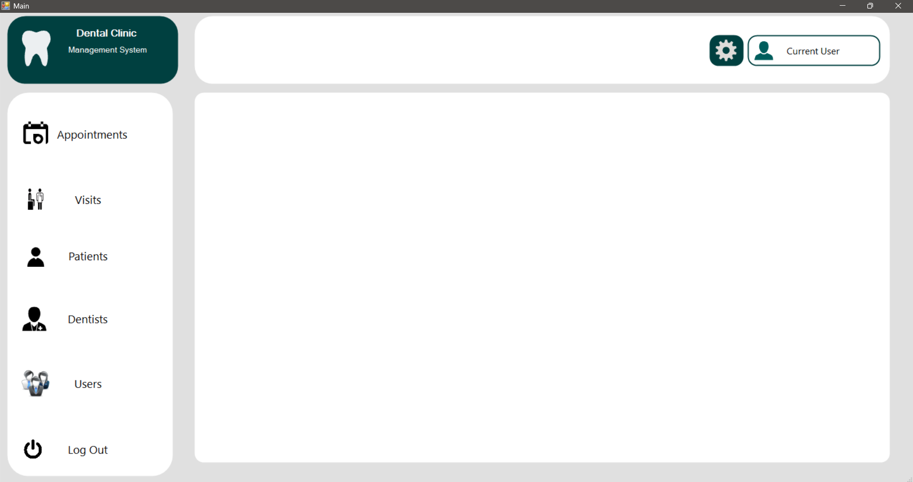
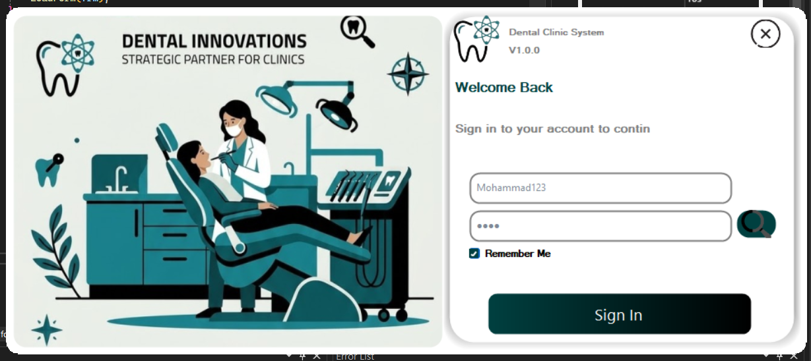

🦷 Dental Clinic Management System

A desktop application developed using C# Windows Forms to manage dental clinic operations.

✨ Features

- Patients Management
- Dentists Management
- Appointments Management
- Visits Management
- Performed Treatments
- Prescriptions Management
- Invoices Management
- Payments Management
- Treatment Types Management
- Users Management

🏗️ Architecture

The project follows Three-Tier Architecture:

- Presentation Layer: Windows Forms.
- Business Layer: Business logic and validation.
- Data Access Layer: Database operations using ADO.NET.

🛠️ Technologies Used

- C#
- .NET Framework
- Windows Forms
- SQL Server
- ADO.NET
- Visual Studio 2022
- Guna UI2

📸 Screenshots

🔐 Login Form

  

🖥️ Main Form

  

🚀 How to Run

1. Clone the repository:
   
   git clone https://github.com/moe-stack24x/Dental-Clinic-Desktop-App.git

2. Open "DentalClinic.sln" in Visual Studio.

3. Configure the SQL Server connection string.

4. Create the database and configure its tables.

5. Build and run the project.

👨‍💻 Author

Mohamed Idris

GitHub: "moe-stack24x" (https://github.com/moe-stack24x)
